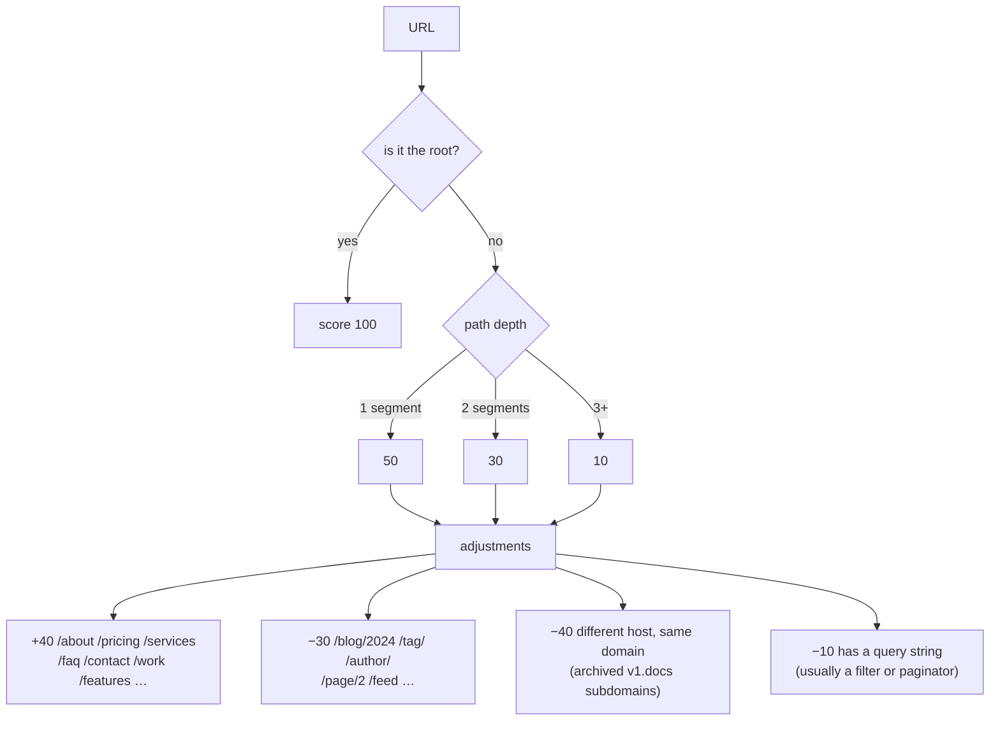
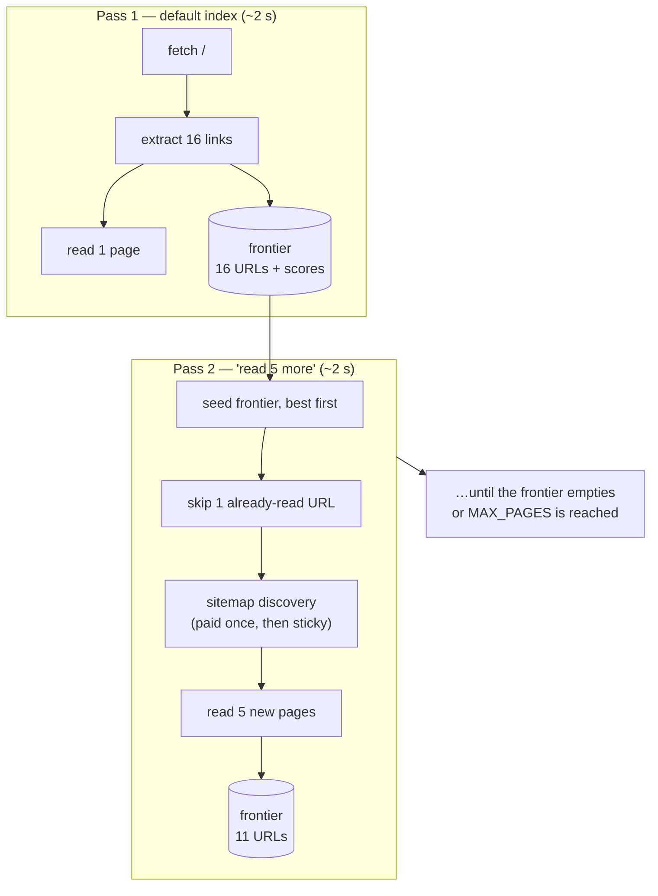
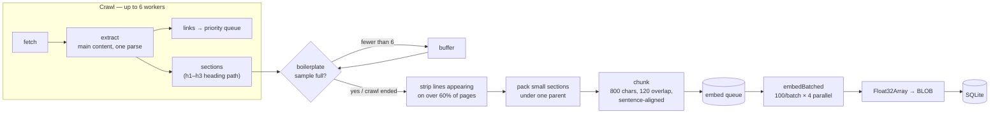
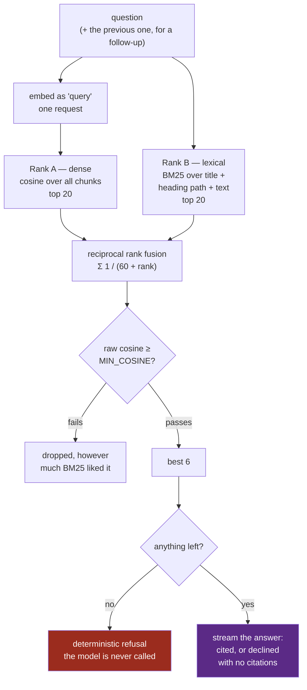
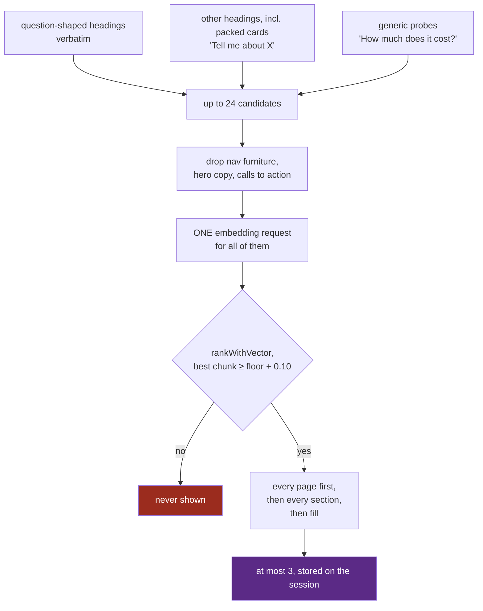
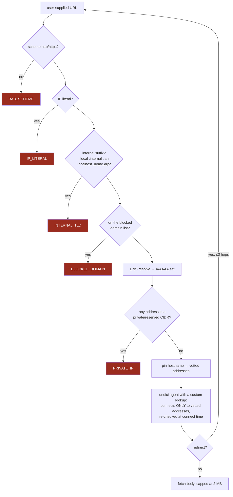
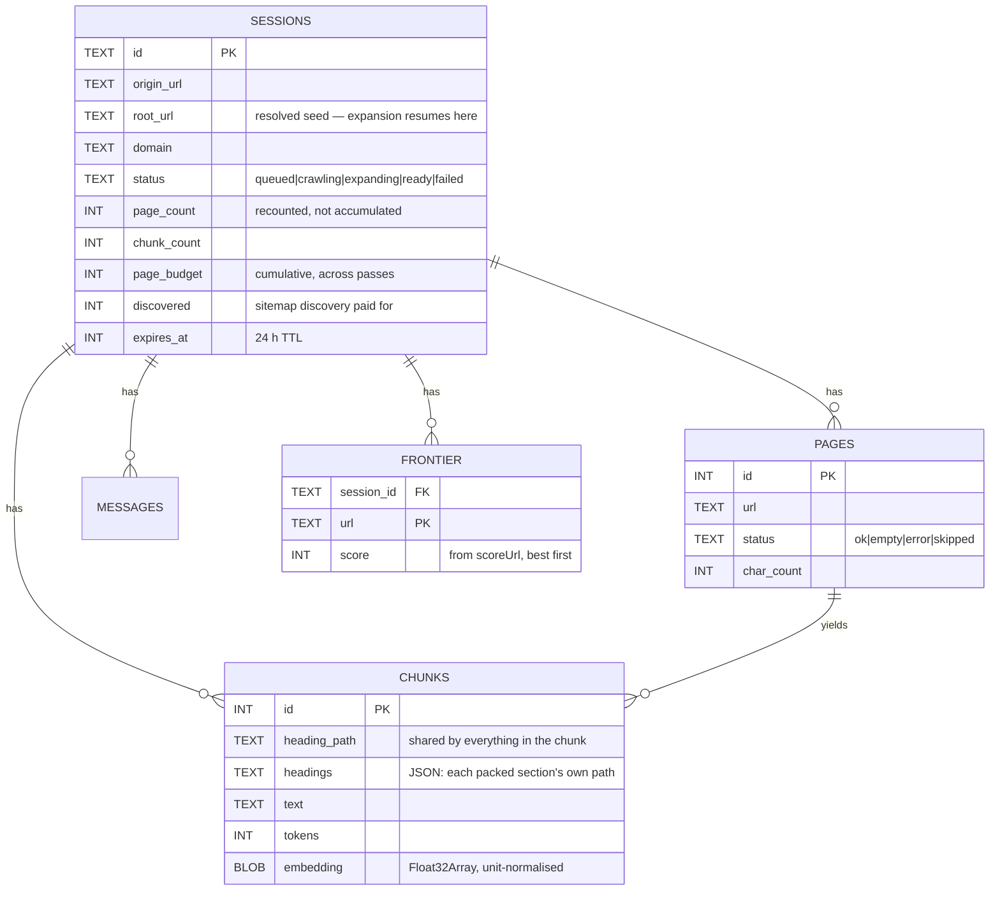
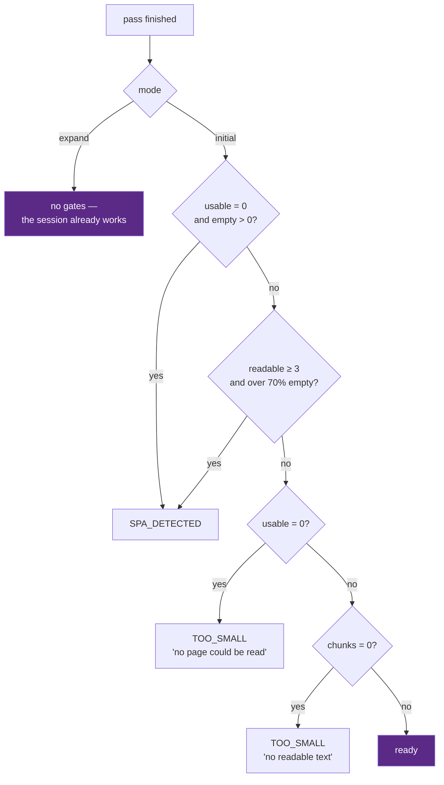

# Instant Site Chat

**Paste your website. Watch it get read. Ask it things.**

A public demo for [Kleio](https://kleiosoftware.com). A visitor pastes a URL,
watches the crawl happen live, and is chatting with their own content in about
two seconds. No account, no upload, no waiting.

The conversion mechanism is that they evaluate the work on content they already
know cold — so **retrieval honesty matters more than answer fluency**. A fluent,
confident, wrong answer about the visitor's own website is the single failure
that would kill this demo, and most of the engineering below exists to make
that structurally impossible rather than unlikely.

```
server/   Node 20+ · Express · TypeScript · SQLite (better-sqlite3)
web/      React · Vite · Tailwind — the demo page
widget/   Vanilla TS, shadow DOM, single-file IIFE — the embeddable bundle
deploy/   systemd unit, Caddyfile, provisioning and backup scripts
```

---

## Table of contents

- [The headline number](#the-headline-number)
- [What happens when you paste a URL](#what-happens-when-you-paste-a-url)
- [Crawl scope: one page by default](#crawl-scope-one-page-by-default)
- [The frontier: how "read more" stays cheap](#the-frontier-how-read-more-stays-cheap)
- [The indexing pipeline](#the-indexing-pipeline)
- [Retrieval, and the "not on this site" guarantee](#retrieval-and-the-not-on-this-site-guarantee)
- [Security: the SSRF guard](#security-the-ssrf-guard)
- [Data model](#data-model)
- [Failure taxonomy](#failure-taxonomy)
- [Quick start](#quick-start)
- [Configuration](#configuration)
- [Development commands](#development-commands)
- [Deploying](#deploying)
- [Limits and cost](#limits-and-cost)
- [Credits](#credits)
- [Testing](#testing)

---

## The headline number

The demo used to crawl 25 pages before it would say a word. That is the right
number for *coverage* and the wrong number for a *demo*, where the visitor is
deciding whether to keep watching.

Indexing now reads **the landing page and nothing else** by default, and
everything past it is opt-in — either up front, or afterwards from the chat
screen, where it costs only the new pages.

Measured with `npm run crawl`, crawl phase only, same machine and network:

| Site | Old default (25 pages) | New default (1 page) | Change |
|---|---:|---:|---:|
| `kleiosoftware.com` — 17 pages total | 4,771 ms | **1,771 ms** | **2.7× faster** |
| `11ty.dev` — 1,100+ pages | 15,828 ms | **2,008 ms** | **7.9× faster** |

End to end through the HTTP API, including session creation, embedding and the
SSE handshake, a default index of `kleiosoftware.com` on a freshly started
server completes in **~1.6 s** wall clock — 3.7 s before extraction moved off
jsdom and suggestion verification moved alongside document embedding — and
produces 7 chunks holding 4,000 characters of the page, twice what it used to
keep. Clicking one of the suggested questions then reaches the model with no
embedding round trip at all, because its vector was computed while verifying it.

Three things account for the gain, and only the first is the page cap itself:


1. **The page cap**, obviously — 1 fetch instead of 25.
2. **Sitemap discovery is skipped.** On a one-page pass, every URL a sitemap
   returns goes straight into the frontier unread, so paying up to six requests
   at a 5 s timeout each to find them buys nothing. Discovery is deferred until
   there is a budget to spend on the results, and then paid for exactly once per
   session.
3. **robots.txt is cached per origin.** It was being fetched twice on every
   index — once by `createSession` to reject a disallowed site before creating
   any state, once by the crawler itself. Same document, 3 s timeout, two round
   trips. It is now a promise-keyed 5-minute cache, so concurrent crawls of the
   same origin share one fetch instead of racing to make two.

A fourth, smaller one: the crawl deadline now **scales with the page budget**
(`crawlBudgetMs`). `CRAWL_TIMEOUT_MS` is the budget for a full 25-page crawl;
a one-page pass gets ~9 s. A site that hangs no longer holds a visitor for 45
seconds to fetch one document.

---

## What happens when you paste a URL


Every stage the visitor waits through emits an event. The crawl log is not a
progress bar over an opaque process — it is the process, rendered.

---

## Crawl scope: one page by default

The input screen offers four scopes. The server clamps whatever it receives to
`1..MAX_PAGES`, and an unparseable value falls back to the **default, not the
ceiling** — a malformed request should cost a visitor one page, not twenty-five.

| Scope | What it reads | Sitemap discovery | Crawl time on `11ty.dev` |
|---|---|---|---:|
| `landing page` *(default)* | The seed URL only | skipped | **2,008 ms** |
| `5 pages` | Seed + 4 highest-scored | yes | 6,246 ms |
| `15 pages` | Seed + 14 | yes | 10,456 ms |
| `25 pages` | The ceiling | yes | 15,828 ms |

Measured with `npm run crawl`, crawl phase only. Embedding adds to all four,
and scales with pages read.

Which pages get read when the budget is smaller than the site is decided by
`scoreUrl` in [priority.ts](server/src/crawl/priority.ts). With a 5-page cap on
a 400-page site this is the difference between indexing the About and Pricing
pages and indexing five blog archive pages:



---

## The frontier: how "read more" stays cheap

A one-page default is only half the design. The other half is that reading more
afterwards must not mean starting over.

When a crawl stops, everything still in its priority queue was **discovered,
allowed by robots.txt, in scope, and simply not reached**. That remainder is
persisted as the session's *frontier*. A later pass resumes from it.



What this buys, and what it costs to build:

| Property | How |
|---|---|
| The landing page is never re-fetched | `visited` seeds the crawler's `seen` set before anything is queued |
| Redirects are never re-followed | The resolved root is stored as `sessions.root_url`; expansion passes `resolveSeed: false` |
| Sitemap discovery is paid once | `sessions.discovered` is sticky across passes |
| A page never appears twice in the offer | `saveFrontier` deletes frontier rows whose URL now exists in `pages` |
| Counts stay correct across N passes | `page_count` / `chunk_count` are recounted from the tables, never accumulated in memory |
| The chat keeps working while it runs | Status is `expanding`, not `crawling`; the messages route serves both |
| A failed expansion cannot break a working session | Gates apply in `initial` mode only; the catch path restores `ready` |

Measured on `kleiosoftware.com`: 1 page → `+5` → `+19`, ending at 17 pages and
245 chunks, with the frontier draining 16 → 11 → 0 and **zero** overlap between
frontier rows and pages already read.

The expansion endpoint is rate-limited **separately** from indexing. With a
one-page default, reading more is the normal path — charging it against the
three-indexes-per-hour budget would make the default setting feel like a trap.

---

## The indexing pipeline

Crawling and embedding overlap. Chunks are pushed onto an embed queue as pages
land, and a background loop drains it in parallel batches while the crawl is
still going.



Five decisions worth calling out:

**Extraction reads the page, not an article.** It used to be Readability,
which is built to find the one article in a page. A landing page is not an
article: on `kleiosoftware.com` it kept one block and discarded the services
grid, every case study and the contact details, so the default one-page index
told visitors *"the site does not cover the Kinefolk Studio project"* while that
project sat on its front page. Extraction now takes the page's `<main>` (or its
only `<article>`, or the body), strips page-level navigation, headers, footers
and forms, and walks every text node once, the way the page renders:

| Measured on 20 pages across 12 sites | Readability (before) | Now |
|---|---:|---:|
| Content text that reaches the index | 66% | **94%** |
| `kleiosoftware.com` landing page | 50% | **95%** |
| `python.org` / `squarespace.com` landing pages | 9% / 3% | **91% / 93%** |
| Time per page, warm (same run, same 8 pages) | 177–1,028 ms | 19–207 ms |

The speed matters twice over: parsing is synchronous, so while jsdom worked
through a page every other visitor's stream stalled behind it. The walker also
separates adjacent inline elements that the browser would lay out apart —
`<a>Tell us what you need</a><a>See our work</a>` used to fuse into "needSee" —
and keeps a table row on one line.

**Small sections are packed, not dropped.** Cards, process steps and contact
details are each a heading and a line. Alone, most fall under the 80-character
chunk floor and vanished — the email address, "a quick 15 to 45 minute chat",
what each service is. Runs of small sections under the same parent heading are
now merged up to the 800-character target, each member's heading inlined, so
one chunk answers "what services do you offer?". Runs never cross into a
different parent section, and the chunk remembers every heading packed into it
(`chunks.headings`), which is where suggested questions find them.

**Boilerplate detection is a sampled warm-up.** Nav, cookie banners and footers
survive extraction on plenty of sites, and a line appearing on most pages is
noise in every chunk it lands in. But computing that statistic needs the whole
crawl, and waiting for the whole crawl would serialise the pipeline and give
back the seconds pipelining exists to save. So it warms up on the first 6 pages,
freezes the set, and streams everything after that straight through. Below 4
pages the frequency statistic is meaningless and the pass is a no-op — which
is exactly the case for a one-page index.

**Chunks carry a topic anchor.** What gets embedded is
`page title — heading path\n\ntext`, not the raw text. On a corpus this small a
short chunk otherwise carries no clue what page it came from, and retrieval
measurably suffers.

**Overlap lands on sentence boundaries.** Stepping back a fixed 120 characters
puts the next chunk mid-word — `"e overall accuracy hides…"` — which reads as
broken and hands the embedder a garbled opening token.

---

## Retrieval, and the "not on this site" guarantee

The demo's credibility rests on one property: **it must not answer a question
the site does not cover.** Three layers enforce it, and only the middle one
relies on the model's judgement:

1. A **similarity floor** refuses anything plainly unrelated to the site,
   deterministically, without calling the model.
2. The **model** decides the rest from the excerpts it is shown, and must cite
   what it answers from.
3. A reply that **opens by declining carries no citations**, whatever the model
   appended. The prompt asks for that; the stream enforces it, because the
   model sometimes declines and then adds "[1][2][3]" anyway.

A citation asserts the site genuinely says this, so a refusal is a turn that
cites nothing — and `npm run eval` fails if any absent question comes back
with a citation.



**The floor used to carry the whole guarantee, and it cannot.** It was set at
0.35 for voyage-3-lite on an 8-page index, with a second rule on top: at least
two chunks had to clear it. Re-measured on all 17 pages of `kleiosoftware.com`
with twice the questions, raw cosine does not separate answerable questions
from absent ones at any value:

| Question | Top cosine |
|---|---:|
| One-line facts on the landing page (email, call length, a case study) — right chunk ranked first | 0.25–0.34 |
| Absent questions that name the brand ("Does Kleio hold ISO 9001 certification?") | up to 0.49 |

At 0.35 and two chunks, the default one-page index refused its own email
address, while on the full site four of the five absent eval questions got past
the floor anyway and were refused only because the model declined. So the
floor is now what it can honestly be — a filter for the plainly unrelated,
0.25 for voyage-3-lite — and one chunk is enough, because a fact a page states
once lives in exactly one chunk.

**The floor is applied before the cut to six, not after.** RRF always returns a
ranked list, because BM25 happily matches a stray token. Cutting first let
those lexical matches take all six slots and then be thrown away by the floor,
refusing questions that a better chunk just below the cut would have answered.
Paraphrased questions — no words in common with the page — suffered most.

**Follow-ups are searched with the question before them.** "Who was it built
for?" says nothing about what "it" is. Retrieval embeds the question alone and
with the previous question prepended, in one request, and fuses the two
rankings the way it fuses dense and lexical ones — by summing each chunk's
scores. The combined search finds what the pronoun refers to, the standalone
one keeps a change of subject working, and a chunk that is right for both
outranks one that is merely on the topic. Keeping each search's best score
instead let "Can I try it myself?", asked after the steel classifier, fill all
six slots with that case study's other sections — its call to action first —
while the chunk saying the tool is "deployed, public, and clickable today"
never reached the model.

The floor value is a property of the **embedding model's cosine distribution**,
not of the site, so it does not carry across providers:

| Embedding provider | `MIN_COSINE` default | Basis |
|---|---:|---|
| `local` (bge-small-en-v1.5) | 0.45 | Measured: weakest real answer 0.479; off-topic questions land 0.45–0.55, so nearly all reach the model |
| `voyage` (voyage-3-lite) | 0.25 | Measured: single-sentence facts rank first at 0.25–0.34 |
| `openai` (text-embedding-3-small) | 0.25 | Measured for the old two-chunk gate; not re-measured |
| `gemini` | 0.50 | Provisional until `npm run eval` is run against it |
| `hash` (offline dev) | 0.50 | Provisional; geometry too poor to separate at all |

### Embeddings without a key

`EMBEDDING_PROVIDER=local` runs an open embedding model inside the server with
[transformers.js](https://huggingface.co/docs/transformers.js): no key, no
quota, no network round trip per question. It exists because the free hosted
tiers were the bottleneck — an unbilled Voyage key allows 3 requests a minute,
so every question's embedding queued behind a pacing slot shared by every
visitor.

The model was chosen by measurement: each candidate re-embedded the 216 chunks
of the final eval's indexes, and every eval question ran through the real
`retrieve()`, follow-up fusion included.

| Model | Answering chunk in the top 6 | Mean reciprocal rank |
|---|---:|---:|
| voyage-3-lite (hosted) | 42/42 | 0.839 |
| **bge-small-en-v1.5** (the default) | **42/42** | **0.887** |
| gte-small | 40/42 | 0.863 |
| snowflake-arctic-embed-s | 40/42 | 0.851 |
| all-MiniLM-L6-v2 | 41/42 | 0.850 |
| snowflake-arctic-embed-xs | 41/42 | 0.823 |
| multilingual-e5-small | 41/42 | 0.799 |

End to end — the same eval, the same chat model, only the embedder changed:

| Fixture | voyage-3-lite | bge-small-en-v1.5 (local) |
|---|---:|---:|
| Landing page: answerable / absent refused | 17/18 / 12/12 | **17/18 / 12/12** |
| Whole site: answerable / absent refused | 19/20 / 11/11 | **17/20 / 11/11** |

Of the whole-site difference, one question was lost to a Gemini timeout that
outlasted both hedged requests, and one is a follow-up — "How long does it
last?" after asking about the discovery call — that the local model ranked
sixth of six (its cosine was the highest of the six; keyword matches on "how
long does" outranked it) and the model then declined. Handing the model its
excerpts in cosine order instead would fix that one and raises the answer's
average position for both embedders, but it undoes part of the follow-up
fusion for questions like "Can I try it myself?", so it has not been made.

What it costs, with one inference thread (so a small VM's other vCPU stays with
the event loop) and batches of eight, measured on a desktop CPU, which a
shared-core VM will not match:

| | |
|---|---:|
| Embedding a question | ~7 ms, versus a network round trip |
| The default one-page index (7 chunks + ~20 suggestion candidates) | ~0.5 s |
| A 17-page site (209 chunks) | ~14 s |
| Memory: model loaded / extra while embedding a large site | ~80 MB / up to ~100 MB, held |
| Disk: `node_modules` / the model | ~470 MB / 34 MB |

The model downloads once into `EMBEDDING_CACHE_DIR` (default: a `models/`
folder next to the database — under the systemd unit, the only writable
place) and is loaded at boot, so the first visitor after a deploy does not
wait for it. It is English-only; a site in another language retrieves
noticeably worse than it did on Voyage.

Vectors from two models cannot be compared, and a dot product over mismatched
vectors still returns numbers. So each session records the model that indexed
it, and a session that outlives a change of `EMBEDDING_PROVIDER` is refused —
chat and "read more" alike — with a message to index the site again, rather
than searched with the wrong geometry for the rest of its 24 hours.

### The eval

`npm run eval` runs a fixture end to end — index, retrieve, answer with the
real model — and grades the replies. There are two fixtures, because the
default index and the whole site fail differently:

| Fixture | Pages | Answerable | Absent |
|---|---:|---:|---:|
| `kleiosoftware-landing.json` — what most visitors chat with | 1 | 18 | 12 |
| `kleiosoftware.json` — the whole site | 25 | 20 | 11 |

An answerable question passes only if the reply is cited **and** contains an
expected fact; a cited reply that talks around the question is not an answer.
The sets include paraphrases, which share no words with the page, and
follow-ups, asked after their previous question with real history. Absent
questions include follow-ups whose subject the site covers but whose detail it
does not ("Can I book one on a Sunday?" after asking about discovery calls),
and — on the landing fixture — facts the site states only on inner pages.
Every question is embedded in one request up front, and a provider error is
reported as an error, never scored as a refusal. On quota-limited keys, pace
it — `EMBEDDING_BATCH_SIZE=32 EMBEDDING_CONCURRENCY=1
EMBEDDING_MIN_INTERVAL_MS=25000 npm run eval -- --pace 5000` — and reuse an
index with `--reuse SESSION_ID` rather than re-embedding it. A run of both
fixtures is roughly 75 chat requests, about 15% of a free-tier Gemini day.

Same eval, same site, before and after this round of changes:

| Fixture | Answerable, before | After | Absent refused, before | After |
|---|---:|---:|---:|---:|
| Landing page (default index) | 3/18 | **17/18** | 11/11 ¹ | **12/12** |
| Whole site | 16/20 | **19/20** | 11/11 | **11/11** |

¹ Plus one question lost to a provider timeout, which the harness reports as
an error rather than a refusal. The baseline landing run lost three answers to
Gemini header timeouts; the final runs lost none.

Both remaining misses are follow-ups the model declined — the safe direction.
On the landing page, "Who was it built for?" about a case study whose card says
only "(Built for a master's thesis project.)" is declined in every sample: the
answer is retrieved first, and the model does not read a project as a *who*. On
the whole site, "Can I try it myself?" was a retrieval miss that rank fusion of
follow-ups (above) fixes offline — the answer moves from absent to first among
the six excerpts — but the eval could not be re-run on it the same day: the
Gemini key's free tier allows 500 requests a day, and this work spent them.

`test/retrieval-gate.test.ts` and `test/chat-stream.test.ts` assert the
structural parts offline, with no API key. `parseCitations` then maps `[n]`
markers back to real pages, so a hallucinated citation number resolves to
nothing rather than to a plausible wrong link.

### Suggested questions are verified, not guessed

The empty transcript offers three opening questions. They used to be built in
the browser from page titles, which produced the worst possible outcome: the
app suggesting a question and then refusing it.

The failure was reproducible. Trimming the brand tail off
`FAQ: Custom Websites & AI Models in Pampanga | Kleio` left the bare token
**"FAQ"**, and `Tell me about FAQ` carries so little meaning that nothing
cleared the cosine floor — the deterministic refusal fired without the model
ever being called.

Measured against voyage-3-lite on a real index:

| Candidate style | Cleared the gate | Lowest top-cosine (floor 0.35) |
|---|---|---|
| Full heading path | 48/48 | 0.450 |
| Question-shaped heading, verbatim | 41/45 | 0.445 |
| Last heading segment | 15/18 | 0.000 |
| Page title *(what it used to do)* | 4/4 | **0.379** |

Heading-derived questions clear the floor by 0.10 or more; title-derived ones
cleared it by as little as 0.029. And when suggestions later moved to the
server, the one title-based suggestion `kleiosoftware.com` was offered — "Tell
me about Custom Website & AI Development in Pampanga" — was declined by the
model when clicked. **Page titles are no longer candidates.**

Candidates come from the page's headings — including the headings of cards that
were packed into one chunk, which each chunk records — plus a few generic
questions. Every one is run through *the very same retrieval that will answer
it*, and held to a higher bar than answering: its best chunk must clear the
floor by 0.10, not merely reach it. The floor decides what the model may see; a
suggestion should be something the page plainly covers. Only survivors are
ever shown:



Spreading across sections matters on the default one-page index: three
questions about three cards of one services grid tell a visitor less than one
each about services, past work and the process.

Three details make this cheap. `rankWithVector` splits the ranking half of
`retrieve` from the embedding half, so checking twenty-four candidates costs
**one** HTTP request rather than twenty-four — the arithmetic is a dot product
over vectors already in memory. That request goes out alongside the documents'
own rather than after them, unless embedding is paced (then the documents go
first, since pacing hands out slots in call order). And query vectors are kept
in memory per embedder, so clicking a suggestion — usually a visitor's first
question — costs no embedding request at all, and the generic probes are
embedded once per process rather than once per site.

The wait is bounded, too: `ready` fires without the suggestions if verification
has not landed in 2.5 s, the client polls while `startersPending` is true, and
an index that works is never failed because the extra call for its suggestions
did not.

If nothing can be verified, nothing is offered. A landing page that is all hero
copy legitimately yields one suggestion or none, and that is the honest answer
rather than three buttons that lead to a refusal. The same verified questions
are what a deterministic refusal offers instead — it used to read page titles
back, which made "You could ask about FAQ" a thing the app said.

---

## Security: the SSRF guard

This endpoint fetches arbitrary URLs supplied by anonymous users, from inside a
cloud VM that has a metadata service on `169.254.169.254`. That is the textbook
SSRF setup, so the guard gets 20 dedicated tests.



The part that matters most is the **pinned lookup**. Validating a hostname and
then handing it to a normal HTTP client leaves a DNS-rebinding window: the
resolver can return a public address to the guard and a private one to the
connect. The undici dispatcher here refuses to connect to any address the guard
did not vet, and re-runs the CIDR check at connect time, so a bug upstream
cannot become an outbound request to a private address.

Blocked CIDRs are a superset of the usual list: RFC1918, loopback, link-local
(where cloud metadata lives), CGNAT, multicast, the three TEST-NETs, benchmark
space, and IPv4-mapped IPv6 (`::ffff:0:0/96`) — a resolver returning those is
itself a bypass vector.

Every hop of a redirect chain is re-guarded. A redirect that walks off the
origin site is fetched safely but **never becomes a citable source**: it is
recorded as `skipped`, with no text and no chunks.

---

## Data model



**Vectors live in SQLite as `Float32Array` blobs** and cosine is a plain dot
product in-process — unit-normalisation at embed time makes that valid. At a
few hundred to a few thousand vectors per session this is microseconds, and the
operational simplicity beats running a vector database for a demo that throws
its data away every 24 hours. Each session's index is cached in memory for 10
minutes and invalidated explicitly whenever a pass writes new chunks.

`root_url`, `page_budget`, `discovered`, `starters` and `chunks.headings` were
added after first deployment. `CREATE TABLE IF NOT EXISTS` will not alter a
table that already exists, so `db.ts` runs an idempotent `PRAGMA table_info` /
`ALTER TABLE ADD COLUMN` migration on open.

---

## Failure taxonomy

Every failure path gets a specific, actionable message. **None of them falls
back to generic "something went wrong" text** — and there is a test asserting
that.

| Code | When | What the visitor is told |
|---|---|---|
| `INVALID_URL` | Bad scheme, or a bare word like `banana` | Names the actual problem — a non-http scheme is distinguished from a typo |
| `BLOCKED_HOST` | Private IP, IP literal, internal TLD, blocklist | Refused, without leaking why it is interesting |
| `UNREACHABLE` | DNS failure on a plausible hostname | The domain could not be resolved |
| `ROBOTS_DISALLOWED` | robots.txt disallows the seed | Checked **before** a session row exists, so nothing is created |
| `SPA_DETECTED` | Pages loaded, none carried text | "Renders its text in the browser" — the accurate diagnosis |
| `TOO_SMALL` | Nothing readable at all | Distinguishes "could not read the page" from "page had no text" |
| `RATE_LIMITED` | Per-IP, per-day, or a provider 429 | Says which limit, and when it resets |
| `NOT_READY` | Message sent during a **first** index | Not raised during expansion — the index already works |

The readability gate is about **content, not page count**. The old rule required
three usable pages, which would now reject the common case. What still has to
be refused is a site with no readable text, because a chatbot over an empty
index is worse than an honest failure:



---

## Quick start

```bash
npm install
cp .env.example .env      # then fill in the two API keys
npm run dev               # API on :8080
npm run dev:web           # demo page on :5173, proxied to the API
```

Native modules (`better-sqlite3`, `esbuild`) need their install scripts to run.
npm 11 blocks these by default; if `npm install` warns about `allow-scripts`:

```bash
npm install-scripts approve better-sqlite3
npm install-scripts approve esbuild
npm install
```

It will also list `onnxruntime-node` and `protobufjs`. Leave those unapproved:
the local embedder only needs onnxruntime's bundled CPU binaries, and its
postinstall exists to download the CUDA runtime on Linux.

---

## Configuration

### Providers and keys

| Variable | Purpose |
|---|---|
| `CHAT_PROVIDER` | `anthropic` (default) or `gemini`. |
| `ANTHROPIC_API_KEY` | Chat, when `CHAT_PROVIDER=anthropic`. Indexing works without it; answering fails. |
| `GEMINI_API_KEY` | Chat, when `CHAT_PROVIDER=gemini`. |
| `EMBEDDING_PROVIDER` | `openai` (default), `voyage`, `gemini`, `local` (in-process, no key — see [Embeddings without a key](#embeddings-without-a-key)), or `hash`. |
| `OPENAI_API_KEY` | Embeddings, when `EMBEDDING_PROVIDER=openai`. Without it, indexing fails. |
| `EMBEDDING_CACHE_DIR` | Where `local` keeps its downloaded model. Defaults to `models/` next to the database. |
| `IP_HASH_SALT` | Salts the rate-limit IP hashes. **Change from the default.** |
| `ADMIN_TOKEN` | Bearer token for `/admin/stats`. Unset disables the route. |
| `PUBLIC_WIDGET_ORIGIN` | Public origin of *this API*. The embed snippet is built from it, so it must be where `widget.js` is actually served — not where the demo page is hosted. |

`CHAT_MODEL` is provider-specific and defaults per provider:
`claude-haiku-4-5-20251001` for Anthropic (the pinned snapshot; the dateless
alias `claude-haiku-4-5` resolves to the same model — both verified against the
live Models API), and `gemini-3.5-flash-lite` for Gemini. A value belonging to
the *other* provider is ignored in favour of that default, so switching
`CHAT_PROVIDER` alone never sends a model id the provider cannot resolve.

Chat sits behind a one-function interface in
[providers.ts](server/src/chat/providers.ts), the same way the embedder does.
Adding a provider means writing one `ChatModel` and touching nothing else.
Speed is the product here, so no thinking or `effort` parameter is requested
from either provider — and none is needed: `gemini-3.5-flash-lite` reports zero
thinking tokens without one.

Gemini requests are **hedged**. Most start streaming in about a second, but
about one call in twenty sent no headers at all until the 30-second timeout,
leaving a visitor watching "writing an answer" before an error. If the first
request has sent nothing back after `CHAT_HEDGE_MS` (4 s), an identical second
one starts and whichever answers first is streamed; the other is cancelled. A
fast error still wins the race and is reported as before.

`ANTHROPIC_WORKSPACE_ID` is only needed for an identity-linked Anthropic key,
which rejects every request without it. `GEMINI_BASE_URL` overrides the Gemini
endpoint, for a proxy or for tests.

### Crawl scope

| Variable | Default | Purpose |
|---|---:|---|
| `DEFAULT_PAGES` | `1` | What a visitor gets without asking. `1` skips sitemap discovery entirely. |
| `MAX_PAGES` | `25` | Ceiling a visitor may opt into, in one pass or cumulatively. |
| `EXPAND_STEP` | `5` | Pages added by one "read more". |
| `CRAWL_TIMEOUT_MS` | `45000` | Budget for a **full** `MAX_PAGES` crawl. Shorter crawls scale down from it. |

### Throughput and limits

| Variable | Default | Purpose |
|---|---:|---|
| `EMBEDDING_BATCH_SIZE` | `100` | Texts per embedding request. |
| `EMBEDDING_CONCURRENCY` | `4` | Embedding round trips in flight. |
| `EMBEDDING_MIN_INTERVAL_MS` | `0` | Spacing between request starts, for low-quota keys. |
| `CONCURRENT_CRAWLS` | `3` | Site-wide. Really "N × 6 fetched pages in flight" — memory, not CPU, is the ceiling. |
| `INDEX_PER_IP_PER_HOUR` | `3` | New indexes. |
| `EXPANDS_PER_IP_PER_HOUR` | `10` | Separate budget — reading more is the normal path now. |
| `MESSAGES_PER_IP_PER_HOUR` | `60` | |
| `MAX_MESSAGES_PER_SESSION` | `20` | |
| `DAILY_INDEX_CAP` | `200` | Global. |
| `MIN_COSINE` | per provider | Retrieval floor. Set only to override. |
| `CHAT_HEDGE_MS` | `4000` | Start a second chat request if the first is silent this long. `0` disables. |

An unbilled Voyage key — 3 requests and 10,000 tokens a minute — needs
`16 / 1 / 21000` for the three embedding variables
([deploy/env.production.example](deploy/env.production.example) has the
arithmetic). That completes, but every embedding request then waits for a
21-second slot shared by all visitors, including the one each question needs
before its answer can start: a question asked while someone else's index is
embedding can wait a minute or more. Adding a payment method lifts the limits,
and the free tokens still apply. Meanwhile two things soften it: clicking a
suggested question costs no embedding request, and a follow-up's two searches
share one. Or leave the hosted providers out of it: `EMBEDDING_PROVIDER=local`
has no limits at all ([Embeddings without a key](#embeddings-without-a-key)),
and takes `0` for the interval — pacing only ever applied to HTTP providers.

The chat side has a ceiling of its own on a free-tier Gemini key: **500
requests per model per day**, shared by everything using that Google Cloud
project, and also a per-minute limit that a handful of simultaneous visitors
can reach. Past the daily limit every question gets the rate-limit message
until the quota resets. At 20 messages a session that is 25 fully used
sessions a day, against a `DAILY_INDEX_CAP` of 200.

---

## Development commands

```bash
npm run crawl -- https://example.com          # crawl only, prints to stdout
npm run crawl -- https://example.com --max 1  # what the default index actually does
npm --workspace server run index-site -- URL  # crawl + chunk + embed into SQLite
npm --workspace server run dump -- SESSION_ID # print a session's chunks to read
npm run eval                                  # the honesty gate, whole site
npm run eval -- --fixture eval/fixtures/kleiosoftware-landing.json   # the default index
npm test                                      # 146 tests
```

`npm run crawl` reports the frontier, which is the fastest way to see what a
larger scope *would* reach:

```
domain          kleiosoftware.com
elapsed         1771ms
robots.txt      loaded
sitemap urls    0
pages fetched   1  (ok 1 / empty 0 / error 0)
stopped because page cap
frontier        16 discovered, unread  (next: /work, /faq, /services/portfolio-websites)
empty ratio     0%
```

Both CLIs default `--max` to `MAX_PAGES` rather than `DEFAULT_PAGES`: they are
diagnostic tools, and you run them to see what the crawler *can* find.

`EMBEDDING_PROVIDER=hash` swaps in a deterministic offline embedder so the
pipeline runs without an API key. It is for exercising plumbing only — its
vector geometry is poor enough that the similarity floor does not separate
on-topic from off-topic queries, which is why `npm run eval` refuses to run
with it.

---

## Deploying

One Compute Engine VM, single origin behind Caddy: Caddy serves the built page
off disk and proxies `/api`, `/healthz` and `/widget.js` to Node on `:8080`.
The full runbook is [deploy/README.md](deploy/README.md).

```bash
VM=sitechat ZONE=us-central1-a ./deploy/deploy.sh
```

**The app cannot go serverless.** `jobs.ts` keeps live crawls — event buffer and
SSE subscribers — in an in-process `Map`, and SQLite needs a disk that outlives
a request, so it needs exactly one persistent process. Vercel and Firebase
Functions are out; Cloud Run only works pinned to one instance and still loses
the database on every recycle.

`deploy/Caddyfile` excludes the SSE routes from both proxy buffering *and*
`encode` — compression buffers, so gzip alone would deliver the crawl log in one
lump at the end, which defeats the entire point.

The demo page is served from the same origin as the API because
[web/src/api.ts](web/src/api.ts) uses relative paths. Moving it to Firebase
Hosting is possible but needs client and CORS changes first — see the last
section of the deploy runbook.

`deploy/provision.sh` sets up a nightly `backup.sh` cron. The 24-hour TTL means
a lost day costs nothing much.

---

## Limits and cost

Landing page by default · up to 25 pages per session · 45 s hard cap on a full
crawl, scaled down for smaller ones · 3 indexes per IP per hour · 10 expansions
per IP per hour · 60 messages per IP per hour · 20 messages per session · 3
concurrent crawls · 200 indexes per day · sessions swept hourly, TTL 24 h.

The one-page default cuts embedding cost harder than it cuts time. Measured on
`kleiosoftware.com`, a visitor who never expands costs about **4%** of a full
25-page index:

| | 25 pages | Default (1 page) |
|---|---:|---:|
| Pages fetched | 17 *(site exhausted)* | 1 |
| Extra HTTP requests besides the pages | up to 8 | 1 |
| Chunks embedded | 209 | 7 |
| Embedding tokens | 29,177 | **1,139** |

The current extraction keeps roughly twice the landing page's text that
Readability did (the one-page index was 628 tokens before), and the chunks are
fuller rather than more numerous: packing small sections cut the full site
from 245 chunks to 209 while it grew from 100,000 to 113,000 characters.

The "extra requests" row is the fixed overhead a crawl pays before it reads
anything: robots.txt twice (once in `createSession`, once in the crawler) plus
up to six sitemap fetches. It is now one cached robots.txt.

The risk was always volume rather than unit price, which is what the caps are
for. `/admin/stats` reports the day's token usage and an estimated cost, keyed
by real model id — keying on `config.chatModel` priced every provider's model
at Claude Haiku's rate, and a model with no published rate is listed under
`unpricedModels` rather than silently costed at zero.

---

## Credits

The tab icon is after Lucide's [`message-square-text`](https://lucide.dev/icons/message-square-text)
(ISC licence; portions derive from Feather, MIT). It is redrawn as filled
geometry rather than strokes in [web/public/favicon.svg](web/public/favicon.svg):
the source icon is a 2px stroke on a 24-unit grid, which at a 16px favicon
lands near one device pixel and smears, whereas a solid bubble with knocked-out
text slots keeps its silhouette. `web/tools/make-favicon.py` regenerates the
`.ico` (16/24/32/48/64, the smallest carrying a single thicker text slot
because two smear together at that size) and the 180px apple-touch icon from
the same geometry.

Type is [Archivo](https://fonts.google.com/specimen/Archivo) (OFL).

## Testing

```bash
npm test          # 146 tests, no API key required
npm run eval      # honesty and answers against real models — needs keys
```

| Suite | Tests | Covers |
|---|---:|---|
| `ssrf.test.ts` | 51 | CIDR blocks, IP literals, internal TLDs, IPv4-mapped IPv6, DNS pinning |
| `errors.test.ts` | 14 | Every failure code and message; the frontier's persistence, dedupe and expansion semantics; suggestions embedding alongside the documents, and after them when paced; the embedding model recorded per session |
| `starters.test.ts` | 13 | Every suggested question is asked back through the real retrieval; the higher bar; packed-card headings; no titles; spread across sections |
| `retrieval-gate.test.ts` | 15 | The floor, applied before the top-6 cut; single-chunk answers; follow-ups searched with their previous question in one request and rank-fused; the query-vector cache; sessions indexed by another model refused |
| `extract.test.ts` | 10 | Card grids in bare divs kept, page chrome dropped, adjacent inline elements not fused, headers inside `<main>` kept, container choice |
| `chunk.test.ts` | 7 | Small sections packed under their parent, never across sections; one-line facts kept |
| `redirect.test.ts` | 6 | Seed resolution, off-site redirects, hop limits |
| `history.test.ts` | 6 | Pairing user turns to answers, dropping orphans |
| `local-embed.test.ts` | 6 | The in-process model (mocked): loaded once and lazily, single-threaded, into the writable cache; query prefix; batches of eight; one inference at a time; a failed download retried |
| `chat-stream.test.ts` | 6 | A reply that opens by declining loses every citation, even split across stream pieces; answers stream untouched |
| `hedge.test.ts` | 5 | A silent chat request is raced by a second; the loser is cancelled; fails only when both do |
| `refusal-text.test.ts` | 4 | Refusals offer verified questions, never page titles, and carry no citation markers |
| `gemini-stream.test.ts` | 3 | SSE frames split across network chunks |

The tests that matter most are the ones asserting things the product would
quietly survive being wrong about: that a refusal never cites a page, that an
absent question is never answered, that a frontier never re-offers a page
already read, that a suggested question is never one the app would refuse, and
that no visitor-facing message ever degrades to "something went wrong".
