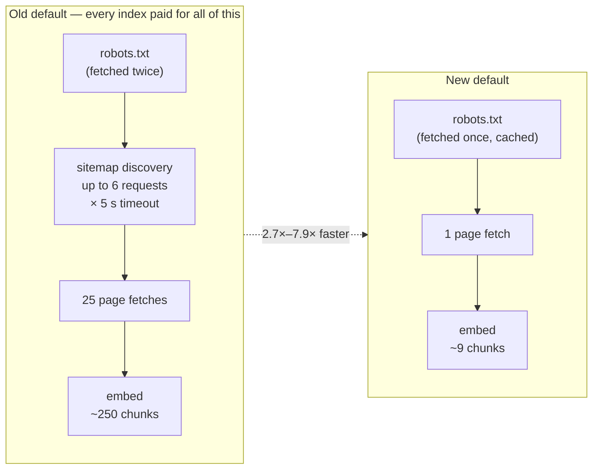
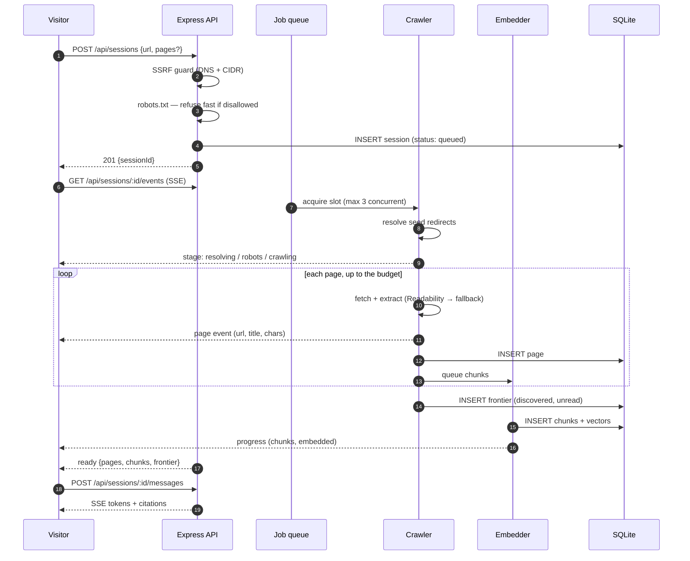
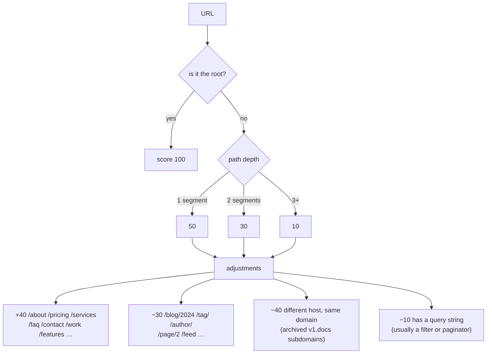
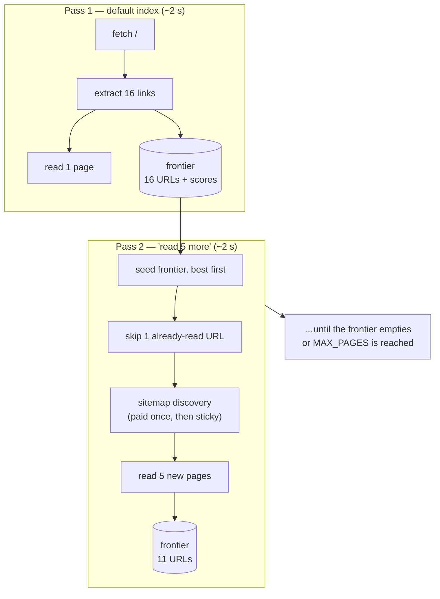
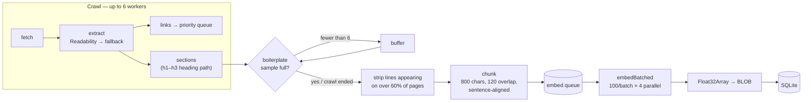
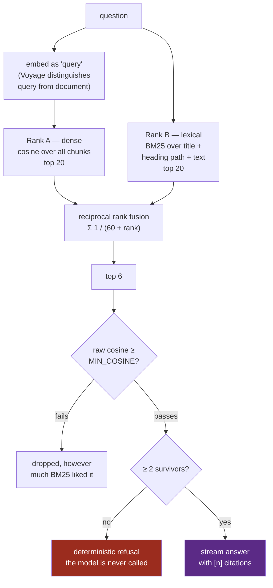
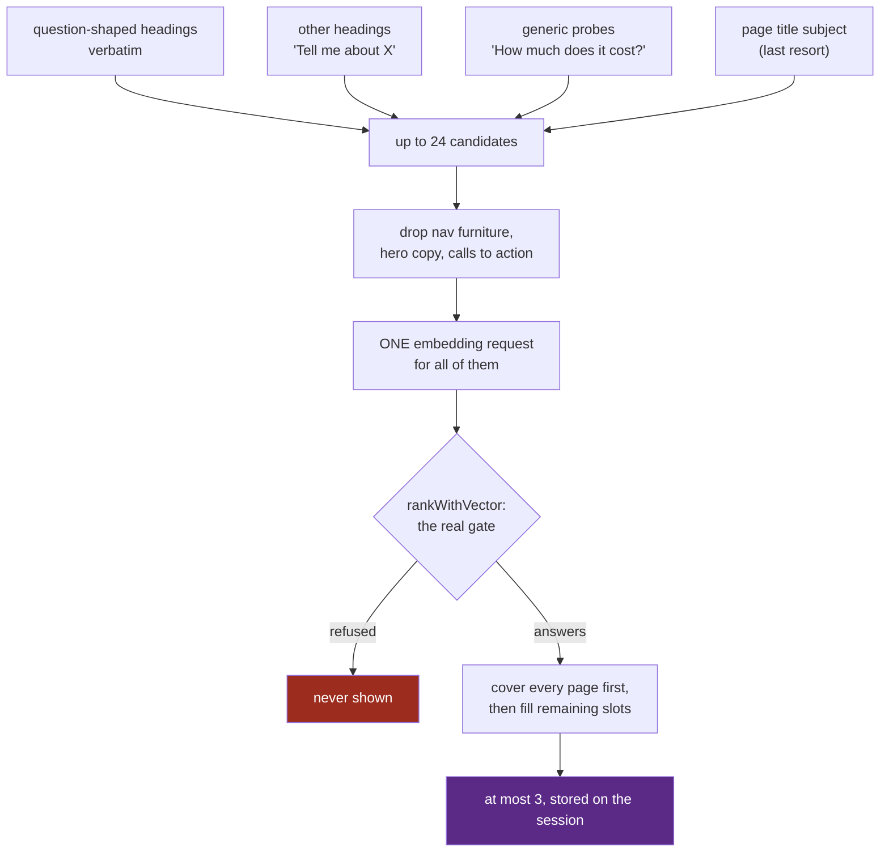
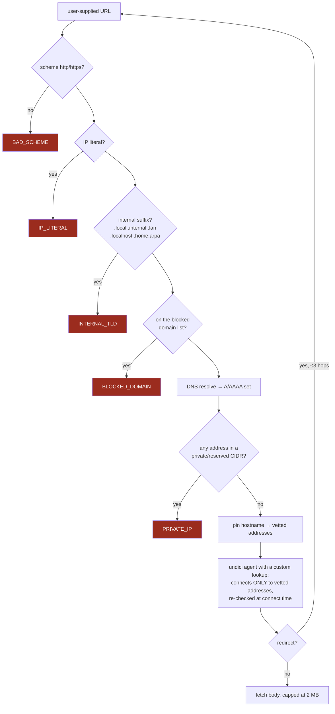
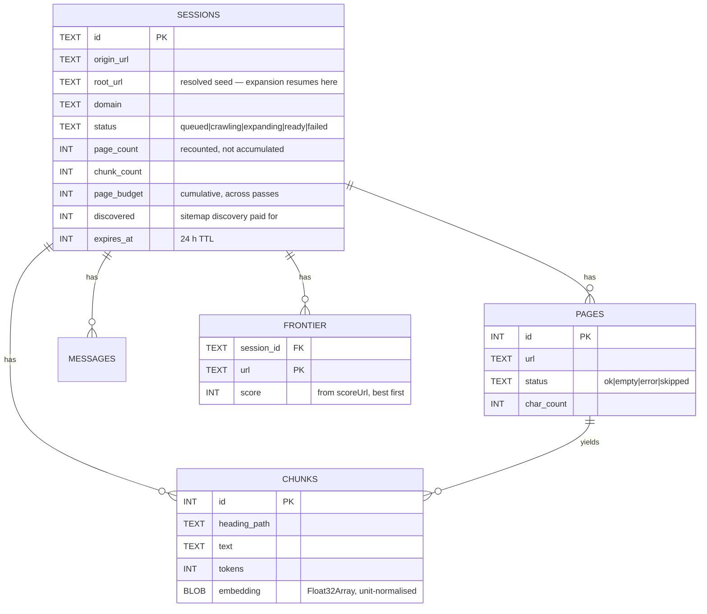
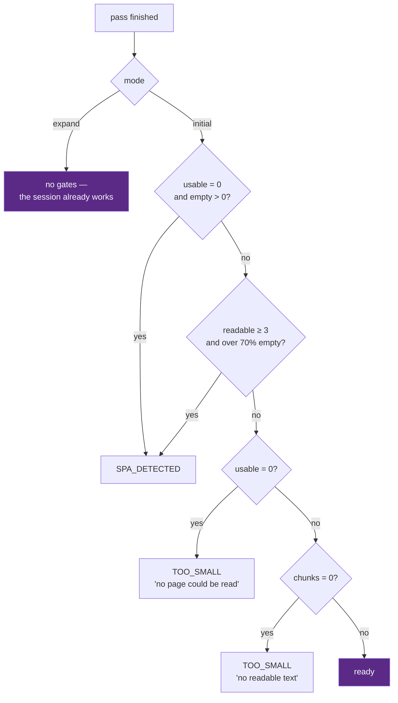

# Instant Site Chat

**Paste your website. Watch it get read. Ask it things.**

A public demo for [Kleio](https://kleiosoftware.com). A visitor pastes a URL,
watches the crawl happen live, and is chatting with their own content in about
two seconds. No account, no upload, no waiting.

The conversion mechanism is that they evaluate the work on content they already
know cold — so **retrieval honesty matters more than answer fluency**. A fluent,
confident, wrong answer about the visitor's own website is the single failure
that would kill this demo, and most of the engineering below exists to make
that structurally impossible rather than unlikely.

```
server/   Node 20+ · Express · TypeScript · SQLite (better-sqlite3)
web/      React · Vite · Tailwind — the demo page
widget/   Vanilla TS, shadow DOM, single-file IIFE — the embeddable bundle
deploy/   systemd unit, Caddyfile, provisioning and backup scripts
```

---

## Table of contents

- [The headline number](#the-headline-number)
- [What happens when you paste a URL](#what-happens-when-you-paste-a-url)
- [Crawl scope: one page by default](#crawl-scope-one-page-by-default)
- [The frontier: how "read more" stays cheap](#the-frontier-how-read-more-stays-cheap)
- [The indexing pipeline](#the-indexing-pipeline)
- [Retrieval, and the "not on this site" guarantee](#retrieval-and-the-not-on-this-site-guarantee)
- [Security: the SSRF guard](#security-the-ssrf-guard)
- [Data model](#data-model)
- [Failure taxonomy](#failure-taxonomy)
- [Quick start](#quick-start)
- [Configuration](#configuration)
- [Development commands](#development-commands)
- [Deploying](#deploying)
- [Limits and cost](#limits-and-cost)
- [Credits](#credits)
- [Testing](#testing)

---

## The headline number

The demo used to crawl 25 pages before it would say a word. That is the right
number for *coverage* and the wrong number for a *demo*, where the visitor is
deciding whether to keep watching.

Indexing now reads **the landing page and nothing else** by default, and
everything past it is opt-in — either up front, or afterwards from the chat
screen, where it costs only the new pages.

Measured with `npm run crawl`, crawl phase only, same machine and network:

| Site | Old default (25 pages) | New default (1 page) | Change |
|---|---:|---:|---:|
| `kleiosoftware.com` — 17 pages total | 4,771 ms | **1,771 ms** | **2.7× faster** |
| `11ty.dev` — 1,100+ pages | 15,828 ms | **2,008 ms** | **7.9× faster** |

End to end through the HTTP API, including session creation, embedding and the
SSE handshake, a default index of `kleiosoftware.com` completes in **~2.4 s**
wall clock and produces 9 chunks from 2,192 characters.

Three things account for the gain, and only the first is the page cap itself:



1. **The page cap**, obviously — 1 fetch instead of 25.
2. **Sitemap discovery is skipped.** On a one-page pass, every URL a sitemap
   returns goes straight into the frontier unread, so paying up to six requests
   at a 5 s timeout each to find them buys nothing. Discovery is deferred until
   there is a budget to spend on the results, and then paid for exactly once per
   session.
3. **robots.txt is cached per origin.** It was being fetched twice on every
   index — once by `createSession` to reject a disallowed site before creating
   any state, once by the crawler itself. Same document, 3 s timeout, two round
   trips. It is now a promise-keyed 5-minute cache, so concurrent crawls of the
   same origin share one fetch instead of racing to make two.

A fourth, smaller one: the crawl deadline now **scales with the page budget**
(`crawlBudgetMs`). `CRAWL_TIMEOUT_MS` is the budget for a full 25-page crawl;
a one-page pass gets ~9 s. A site that hangs no longer holds a visitor for 45
seconds to fetch one document.

---

## What happens when you paste a URL



Every stage the visitor waits through emits an event. The crawl log is not a
progress bar over an opaque process — it is the process, rendered.

---

## Crawl scope: one page by default

The input screen offers four scopes. The server clamps whatever it receives to
`1..MAX_PAGES`, and an unparseable value falls back to the **default, not the
ceiling** — a malformed request should cost a visitor one page, not twenty-five.

| Scope | What it reads | Sitemap discovery | Crawl time on `11ty.dev` |
|---|---|---|---:|
| `landing page` *(default)* | The seed URL only | skipped | **2,008 ms** |
| `5 pages` | Seed + 4 highest-scored | yes | 6,246 ms |
| `15 pages` | Seed + 14 | yes | 10,456 ms |
| `25 pages` | The ceiling | yes | 15,828 ms |

Measured with `npm run crawl`, crawl phase only. Embedding adds to all four,
and scales with pages read.

Which pages get read when the budget is smaller than the site is decided by
`scoreUrl` in [priority.ts](server/src/crawl/priority.ts). With a 5-page cap on
a 400-page site this is the difference between indexing the About and Pricing
pages and indexing five blog archive pages:



---

## The frontier: how "read more" stays cheap

A one-page default is only half the design. The other half is that reading more
afterwards must not mean starting over.

When a crawl stops, everything still in its priority queue was **discovered,
allowed by robots.txt, in scope, and simply not reached**. That remainder is
persisted as the session's *frontier*. A later pass resumes from it.



What this buys, and what it costs to build:

| Property | How |
|---|---|
| The landing page is never re-fetched | `visited` seeds the crawler's `seen` set before anything is queued |
| Redirects are never re-followed | The resolved root is stored as `sessions.root_url`; expansion passes `resolveSeed: false` |
| Sitemap discovery is paid once | `sessions.discovered` is sticky across passes |
| A page never appears twice in the offer | `saveFrontier` deletes frontier rows whose URL now exists in `pages` |
| Counts stay correct across N passes | `page_count` / `chunk_count` are recounted from the tables, never accumulated in memory |
| The chat keeps working while it runs | Status is `expanding`, not `crawling`; the messages route serves both |
| A failed expansion cannot break a working session | Gates apply in `initial` mode only; the catch path restores `ready` |

Measured on `kleiosoftware.com`: 1 page → `+5` → `+19`, ending at 17 pages and
245 chunks, with the frontier draining 16 → 11 → 0 and **zero** overlap between
frontier rows and pages already read.

The expansion endpoint is rate-limited **separately** from indexing. With a
one-page default, reading more is the normal path — charging it against the
three-indexes-per-hour budget would make the default setting feel like a trap.

---

## The indexing pipeline

Crawling and embedding overlap. Chunks are pushed onto an embed queue as pages
land, and a background loop drains it in parallel batches while the crawl is
still going.



Three decisions worth calling out:

**Boilerplate detection is a sampled warm-up.** Nav, cookie banners and footers
survive extraction on plenty of sites, and a line appearing on most pages is
noise in every chunk it lands in. But computing that statistic needs the whole
crawl, and waiting for the whole crawl would serialise the pipeline and give
back the seconds pipelining exists to save. So it warms up on the first 6 pages,
freezes the set, and streams everything after that straight through. Below 4
pages the frequency statistic is meaningless and the pass is a no-op — which
is exactly the case for a one-page index.

**Chunks carry a topic anchor.** What gets embedded is
`page title — heading path\n\ntext`, not the raw text. On a corpus this small a
short chunk otherwise carries no clue what page it came from, and retrieval
measurably suffers.

**Overlap lands on sentence boundaries.** Stepping back a fixed 120 characters
puts the next chunk mid-word — `"e overall accuracy hides…"` — which reads as
broken and hands the embedder a garbled opening token.

---

## Retrieval, and the "not on this site" guarantee

The demo's credibility rests on one property: **it must not answer a question
the site does not cover.** That is enforced structurally, not by asking the
model nicely.



The floor is the load-bearing part. RRF will *always* return a ranked list,
however irrelevant, because BM25 happily matches a stray token. Without the
floor the model receives six confident-looking excerpts about nothing in
particular and writes a fluent wrong answer.

The floor value is a property of the **embedding model's cosine distribution**,
not of the site, so it does not carry across providers:

| Embedding provider | `MIN_COSINE` default | Basis |
|---|---:|---|
| `voyage` (voyage-3-lite) | 0.35 | Measured: separates cleanly anywhere in 0.35–0.375 |
| `openai` (text-embedding-3-small) | 0.25 | Measured |
| `gemini` | 0.50 | Provisional until `npm run eval` is run against it |
| `hash` (offline dev) | 0.50 | Provisional; geometry too poor to separate at all |

`npm run eval` calibrates the floor against real embeddings using 15 questions —
10 answerable, 5 deliberately absent — and **fails the build if any absent
question gets answered**. `test/retrieval-gate.test.ts` asserts the same
property offline, with no API key.

Two further defences sit on top: the system prompt forbids citing a page while
declining (a citation asserts the site genuinely says this), and
`parseCitations` maps `[n]` markers back to real pages, so a hallucinated
citation number resolves to nothing rather than to a plausible wrong link.

### Suggested questions are verified, not guessed

The empty transcript offers three opening questions. They used to be built in
the browser from page titles, which produced the worst possible outcome: the
app suggesting a question and then refusing it.

The failure was reproducible. Trimming the brand tail off
`FAQ: Custom Websites & AI Models in Pampanga | Kleio` left the bare token
**"FAQ"**, and `Tell me about FAQ` carries so little meaning that nothing
cleared the cosine floor — the deterministic refusal fired without the model
ever being called.

Measured against voyage-3-lite on a real index:

| Candidate style | Cleared the gate | Lowest top-cosine (floor 0.35) |
|---|---|---|
| Full heading path | 48/48 | 0.450 |
| Question-shaped heading, verbatim | 41/45 | 0.445 |
| Last heading segment | 15/18 | 0.000 |
| Page title *(what it used to do)* | 4/4 | **0.379** |

Heading-derived questions clear the floor by 0.10 or more; title-derived ones
cleared it by as little as 0.029. But margin is not a guarantee — one candidate
scored a top cosine of **0.736 and was still refused**, because only one chunk
cleared the floor and `minChunksForAnswer` is 2.

So candidates are generated generously and then run through *the very same
gate that will answer them*, and only survivors are ever shown:



Two details make this affordable. `rankWithVector` splits the ranking half of
`retrieve` from the embedding half, so checking twenty-four candidates costs
**one** HTTP request rather than twenty-four — the arithmetic is a dot product
over vectors already in memory, and round trips are the scarce resource on a
rate-limited key. And the wait is bounded: `ready` fires without the
suggestions if verification has not landed in 2.5 s, the client polls while
`startersPending` is true, and an index that works is never failed because the
extra call for its suggestions did not.

If nothing can be verified, nothing is offered. A landing page that is all hero
copy legitimately yields one suggestion or none, and that is the honest answer
rather than three buttons that lead to a refusal.

---

## Security: the SSRF guard

This endpoint fetches arbitrary URLs supplied by anonymous users, from inside a
cloud VM that has a metadata service on `169.254.169.254`. That is the textbook
SSRF setup, so the guard gets 20 dedicated tests.



The part that matters most is the **pinned lookup**. Validating a hostname and
then handing it to a normal HTTP client leaves a DNS-rebinding window: the
resolver can return a public address to the guard and a private one to the
connect. The undici dispatcher here refuses to connect to any address the guard
did not vet, and re-runs the CIDR check at connect time, so a bug upstream
cannot become an outbound request to a private address.

Blocked CIDRs are a superset of the usual list: RFC1918, loopback, link-local
(where cloud metadata lives), CGNAT, multicast, the three TEST-NETs, benchmark
space, and IPv4-mapped IPv6 (`::ffff:0:0/96`) — a resolver returning those is
itself a bypass vector.

Every hop of a redirect chain is re-guarded. A redirect that walks off the
origin site is fetched safely but **never becomes a citable source**: it is
recorded as `skipped`, with no text and no chunks.

---

## Data model



**Vectors live in SQLite as `Float32Array` blobs** and cosine is a plain dot
product in-process — unit-normalisation at embed time makes that valid. At a
few hundred to a few thousand vectors per session this is microseconds, and the
operational simplicity beats running a vector database for a demo that throws
its data away every 24 hours. Each session's index is cached in memory for 10
minutes and invalidated explicitly whenever a pass writes new chunks.

`root_url`, `page_budget` and `discovered` were added after first deployment.
`CREATE TABLE IF NOT EXISTS` will not alter a table that already exists, so
`db.ts` runs an idempotent `PRAGMA table_info` / `ALTER TABLE ADD COLUMN`
migration on open.

---

## Failure taxonomy

Every failure path gets a specific, actionable message. **None of them falls
back to generic "something went wrong" text** — and there is a test asserting
that.

| Code | When | What the visitor is told |
|---|---|---|
| `INVALID_URL` | Bad scheme, or a bare word like `banana` | Names the actual problem — a non-http scheme is distinguished from a typo |
| `BLOCKED_HOST` | Private IP, IP literal, internal TLD, blocklist | Refused, without leaking why it is interesting |
| `UNREACHABLE` | DNS failure on a plausible hostname | The domain could not be resolved |
| `ROBOTS_DISALLOWED` | robots.txt disallows the seed | Checked **before** a session row exists, so nothing is created |
| `SPA_DETECTED` | Pages loaded, none carried text | "Renders its text in the browser" — the accurate diagnosis |
| `TOO_SMALL` | Nothing readable at all | Distinguishes "could not read the page" from "page had no text" |
| `RATE_LIMITED` | Per-IP, per-day, or a provider 429 | Says which limit, and when it resets |
| `NOT_READY` | Message sent during a **first** index | Not raised during expansion — the index already works |

The readability gate is about **content, not page count**. The old rule required
three usable pages, which would now reject the common case. What still has to
be refused is a site with no readable text, because a chatbot over an empty
index is worse than an honest failure:



---

## Quick start

```bash
npm install
cp .env.example .env      # then fill in the two API keys
npm run dev               # API on :8080
npm run dev:web           # demo page on :5173, proxied to the API
```

Native modules (`better-sqlite3`, `esbuild`) need their install scripts to run.
npm 11 blocks these by default; if `npm install` warns about `allow-scripts`:

```bash
npm install-scripts approve better-sqlite3
npm install-scripts approve esbuild
npm install
```

---

## Configuration

### Providers and keys

| Variable | Purpose |
|---|---|
| `CHAT_PROVIDER` | `anthropic` (default) or `gemini`. |
| `ANTHROPIC_API_KEY` | Chat, when `CHAT_PROVIDER=anthropic`. Indexing works without it; answering fails. |
| `GEMINI_API_KEY` | Chat, when `CHAT_PROVIDER=gemini`. |
| `EMBEDDING_PROVIDER` | `openai` (default), `voyage`, `gemini`, or `hash`. |
| `OPENAI_API_KEY` | Embeddings. Without it, indexing fails. |
| `IP_HASH_SALT` | Salts the rate-limit IP hashes. **Change from the default.** |
| `ADMIN_TOKEN` | Bearer token for `/admin/stats`. Unset disables the route. |
| `PUBLIC_WIDGET_ORIGIN` | Public origin of *this API*. The embed snippet is built from it, so it must be where `widget.js` is actually served — not where the demo page is hosted. |

`CHAT_MODEL` is provider-specific and defaults per provider:
`claude-haiku-4-5-20251001` for Anthropic (the pinned snapshot; the dateless
alias `claude-haiku-4-5` resolves to the same model — both verified against the
live Models API), and `gemini-3.5-flash-lite` for Gemini. A value belonging to
the *other* provider is ignored in favour of that default, so switching
`CHAT_PROVIDER` alone never sends a model id the provider cannot resolve.

Chat sits behind a one-function interface in
[providers.ts](server/src/chat/providers.ts), the same way the embedder does.
Adding a provider means writing one `ChatModel` and touching nothing else.
Speed is the product here, so no thinking or `effort` parameter is requested
from either provider.

`ANTHROPIC_WORKSPACE_ID` is only needed for an identity-linked Anthropic key,
which rejects every request without it. `GEMINI_BASE_URL` overrides the Gemini
endpoint, for a proxy or for tests.

### Crawl scope

| Variable | Default | Purpose |
|---|---:|---|
| `DEFAULT_PAGES` | `1` | What a visitor gets without asking. `1` skips sitemap discovery entirely. |
| `MAX_PAGES` | `25` | Ceiling a visitor may opt into, in one pass or cumulatively. |
| `EXPAND_STEP` | `5` | Pages added by one "read more". |
| `CRAWL_TIMEOUT_MS` | `45000` | Budget for a **full** `MAX_PAGES` crawl. Shorter crawls scale down from it. |

### Throughput and limits

| Variable | Default | Purpose |
|---|---:|---|
| `EMBEDDING_BATCH_SIZE` | `100` | Texts per embedding request. |
| `EMBEDDING_CONCURRENCY` | `4` | Embedding round trips in flight. |
| `EMBEDDING_MIN_INTERVAL_MS` | `0` | Spacing between request starts, for low-quota keys. |
| `CONCURRENT_CRAWLS` | `3` | Site-wide. Really "N × 6 concurrent jsdom documents" — memory, not CPU, is the ceiling. |
| `INDEX_PER_IP_PER_HOUR` | `3` | New indexes. |
| `EXPANDS_PER_IP_PER_HOUR` | `10` | Separate budget — reading more is the normal path now. |
| `MESSAGES_PER_IP_PER_HOUR` | `60` | |
| `MAX_MESSAGES_PER_SESSION` | `20` | |
| `DAILY_INDEX_CAP` | `200` | Global. |
| `MIN_COSINE` | per provider | Retrieval floor. Set only to override. |

A free or low-quota embedding key needs roughly `32 / 1 / 21000` for the three
embedding variables. That completes, but it blows the time budget — which is
now far more survivable than it was, because the default index is nine chunks.

---

## Development commands

```bash
npm run crawl -- https://example.com          # crawl only, prints to stdout
npm run crawl -- https://example.com --max 1  # what the default index actually does
npm --workspace server run index-site -- URL  # crawl + chunk + embed into SQLite
npm --workspace server run dump -- SESSION_ID # print a session's chunks to read
npm run eval                                  # the retrieval-honesty gate
npm test                                      # 100 tests
```

`npm run crawl` reports the frontier, which is the fastest way to see what a
larger scope *would* reach:

```
domain          kleiosoftware.com
elapsed         1771ms
robots.txt      loaded
sitemap urls    0
pages fetched   1  (ok 1 / empty 0 / error 0)
stopped because page cap
frontier        16 discovered, unread  (next: /work, /faq, /services/portfolio-websites)
empty ratio     0%
```

Both CLIs default `--max` to `MAX_PAGES` rather than `DEFAULT_PAGES`: they are
diagnostic tools, and you run them to see what the crawler *can* find.

`EMBEDDING_PROVIDER=hash` swaps in a deterministic offline embedder so the
pipeline runs without an API key. It is for exercising plumbing only — its
vector geometry is poor enough that the similarity floor does not separate
on-topic from off-topic queries, which is why `npm run eval` refuses to run
with it.

---

## Deploying

One Compute Engine VM, single origin behind Caddy: Caddy serves the built page
off disk and proxies `/api`, `/healthz` and `/widget.js` to Node on `:8080`.
The full runbook is [deploy/README.md](deploy/README.md).

```bash
VM=sitechat ZONE=us-central1-a ./deploy/deploy.sh
```

**The app cannot go serverless.** `jobs.ts` keeps live crawls — event buffer and
SSE subscribers — in an in-process `Map`, and SQLite needs a disk that outlives
a request, so it needs exactly one persistent process. Vercel and Firebase
Functions are out; Cloud Run only works pinned to one instance and still loses
the database on every recycle.

`deploy/Caddyfile` excludes the SSE routes from both proxy buffering *and*
`encode` — compression buffers, so gzip alone would deliver the crawl log in one
lump at the end, which defeats the entire point.

The demo page is served from the same origin as the API because
[web/src/api.ts](web/src/api.ts) uses relative paths. Moving it to Firebase
Hosting is possible but needs client and CORS changes first — see the last
section of the deploy runbook.

`deploy/provision.sh` sets up a nightly `backup.sh` cron. The 24-hour TTL means
a lost day costs nothing much.

---

## Limits and cost

Landing page by default · up to 25 pages per session · 45 s hard cap on a full
crawl, scaled down for smaller ones · 3 indexes per IP per hour · 10 expansions
per IP per hour · 60 messages per IP per hour · 20 messages per session · 3
concurrent crawls · 200 indexes per day · sessions swept hourly, TTL 24 h.

The one-page default cuts embedding cost harder than it cuts time. Measured on
`kleiosoftware.com` with `npm run index-site`, a visitor who never expands now
costs about **2%** of what they used to:

| | Old default (25 pages) | New default (1 page) |
|---|---:|---:|
| Pages fetched | 17 *(site exhausted)* | 1 |
| Extra HTTP requests besides the pages | up to 8 | 1 |
| Chunks embedded | 245 | 9 |
| Embedding tokens | 31,980 | **689** |
| Index time (crawl + embed) | 5,137 ms | 1,812 ms |

The "extra requests" row is the fixed overhead a crawl pays before it reads
anything: robots.txt twice (once in `createSession`, once in the crawler) plus
up to six sitemap fetches. It is now one cached robots.txt.

The risk was always volume rather than unit price, which is what the caps are
for. `/admin/stats` reports the day's token usage and an estimated cost, keyed
by real model id — keying on `config.chatModel` priced every provider's model
at Claude Haiku's rate, and a model with no published rate is listed under
`unpricedModels` rather than silently costed at zero.

---

## Credits

The tab icon is after Lucide's [`message-square-text`](https://lucide.dev/icons/message-square-text)
(ISC licence; portions derive from Feather, MIT). It is redrawn as filled
geometry rather than strokes in [web/public/favicon.svg](web/public/favicon.svg):
the source icon is a 2px stroke on a 24-unit grid, which at a 16px favicon
lands near one device pixel and smears, whereas a solid bubble with knocked-out
text slots keeps its silhouette. `web/tools/make-favicon.py` regenerates the
`.ico` (16/24/32/48/64, the smallest carrying a single thicker text slot
because two smear together at that size) and the 180px apple-touch icon from
the same geometry.

Type is [Archivo](https://fonts.google.com/specimen/Archivo) (OFL).

## Testing

```bash
npm test          # 100 tests, no API key required
npm run eval      # retrieval honesty against real embeddings — needs a key
```

| Suite | Tests | Covers |
|---|---:|---|
| `ssrf.test.ts` | 20 | CIDR blocks, IP literals, internal TLDs, IPv4-mapped IPv6, DNS pinning |
| `errors.test.ts` | 10 | Every failure code and message; the frontier's persistence, dedupe and expansion semantics |
| `starters.test.ts` | 13 | Every suggested question is asked back through the real gate |
| `retrieval-gate.test.ts` | 10 | The cosine floor and the ≥2-chunk rule, offline |
| `redirect.test.ts` | 6 | Seed resolution, off-site redirects, hop limits |
| `history.test.ts` | 6 | Pairing user turns to answers, dropping orphans |
| `refusal-text.test.ts` | 5 | Refusals contain no citation markers |
| `gemini-stream.test.ts` | 3 | SSE frames split across network chunks |

The tests that matter most are the ones asserting things the product would
quietly survive being wrong about: that a refusal never cites a page, that an
absent question is never answered, that a frontier never re-offers a page
already read, that a suggested question is never one the app would refuse, and
that no visitor-facing message ever degrades to "something went wrong".
